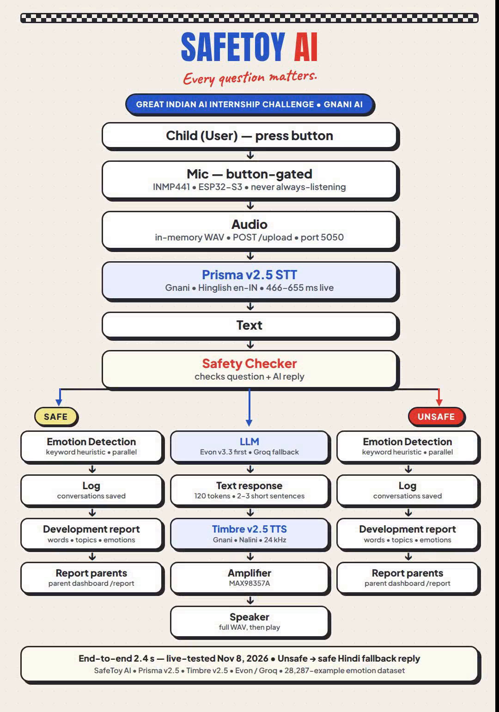

# SafeToy

**Every question matters. Every language deserves to be understood.**

An intelligent, screen-free AI voice companion for children • Powered by Gnani AI

## The Problem

Children ask a hundred questions a day — *Why is the sky blue? How do birds fly? Can we go to the moon?* — but busy parents and unavailable teachers mean many questions go unanswered, and curiosity fades. Most AI toys only make this worse: they are built for English-speaking children, while Indian children naturally speak Hindi, Hinglish, and regional languages.

## Our Solution

SafeToy is a screen-free voice companion that answers a child's questions in their own language, in a friendly, natural voice. No screen, no typing — just conversation. When a child asks, *“Chand pe hum kaise ja sakte hain?”*, SafeToy understands the Hinglish question and replies in simple Hindi, just as a patient friend would.

**Powered by Gnani AI:** At its core are two Gnani AI technologies. **Prisma** understands the child's natural speech across Hindi, Hinglish, and mixed language use. **Timbre** turns the response into natural, human-like speech. Integrated into real hardware, SafeToy responds in **2.4 seconds in our live test** — fast enough to keep a child's curiosity alive. **Prisma understands the child, and Timbre gives that understanding a voice.**

**Built for trust:** Making an AI that talks is easy; making one parents can trust is the real challenge. SafeToy uses **hardware-controlled listening** — the microphone activates only when the child presses the physical button. Both incoming questions and AI responses are checked for unsafe content, so every conversation stays age-appropriate and safe.

**Emotion intelligence:** SafeToy goes beyond answering. We built our own emotion dataset of **28,287 examples across seven emotions**, and SafeToy reads a child's words for how they feel. If a child says, *“Mujhe darr lag raha hai,”* it picks up the fear and responds more gently, adapting to the child's emotional context.

**For parents:** Parents get more than chat logs. Our parent dashboard provides insights into new words learned, topics of interest, learning patterns, and emotional expressions — so parents stay connected to what their child is curious about, learning, and feeling, without needing a screen in the child's hands.

Together, Gnani AI's Prisma and Timbre, our custom safety framework, emotion intelligence, and parent dashboard make SafeToy more than an AI toy. The future of AI should not be limited by language, screens, or accessibility — **every child deserves technology that understands them.** SafeToy brings intelligent, trusted conversation closer to India's next generation.

See the full pitch: [`SafeToy_Solution_Pitch.pdf`](SafeToy_Solution_Pitch.pdf)

## Architecture



---

# SafeToy AI — Low-Latency Gnani Pipeline

For the Great Indian AI Internship Challenge (Gnani AI).
Deadline: **Nov 10, 2026, 11:59 PM IST.**

A low-latency voice pipeline for the SafeToy robot — Gnani Prisma STT,
Groq/Evon LLM, and Gnani Timbre TTS streaming in a single Flask process.

## Pipeline at a glance

| Step | Implementation |
|---|---|
| STT | **Prisma v2.5** via `gnani-vachana`, `en-IN` (Hinglish), retry `hi-IN` |
| LLM | **Evon v3.3 first when available, Groq as automatic fallback** — `LLM_PROVIDER=groq \| evon \| auto`, `stream=True`, 120 tokens, 2–3 short sentences, thinking off for Evon |
| TTS | **Timbre v2.5, voice Nalini, SSE streaming**, 24kHz PCM direct, no ffmpeg |
| Emotion | Fast keyword heuristic in a **parallel thread, never blocks** |
| Audio I/O | **In-memory bytes only**; one WAV file saved for the ESP32 GET |

One process, one port: **5050**.

## Why it is faster

Running each step only after the previous one finishes adds ~3–5 s of
silence. This pipeline overlaps the steps instead:

- LLM **streams**. The moment sentence 1 ends (`...tha.`), it goes to Timbre
  SSE immediately, while sentence 2 is still generating.
- Timbre **streams** PCM per sentence (`GnaniTTSStreamClient.synthesize_stream`).
  Sentences are synthesised in parallel (2 workers) and concatenated into
  one 24 kHz WAV.
- Emotion runs in a background thread. The reply never waits for it.
- No disk for the input, no ffmpeg, reused Gnani/Groq clients (no new
  connection per request), short history (last 6 turns), short answers.

Target (real keys, same Wi-Fi): **first sound ~0.9–1.2 s after button release**,
full short answer ~2 s. The `/upload` JSON returns `timings_ms` so you can
prove it: `stt_ms`, `llm_first_token_ms`, `llm_total_ms`, `tts_ms`, `total_ms`.

Gnani numbers behind this: STT P95 ~200 ms, Timbre sub-250 ms p95. The socket
itself only saves ~50–100 ms per request — the model time dominates, and
streaming is what cuts it.

## ESP32 firmware

`POST /upload` takes a multipart `audio` field and returns the JSON keys
the `.ino` parses: `text`, `ai_response`, `emotion`, `has_audio`,
`audio_url`. Wiring diagram and parts list: `README_original.md`.

Set your PC's IP in `esp32_robot/esp32_robot.ino`:
```cpp
String server_url = "http://YOUR_PC_IP:5050";  // e.g. http://192.168.1.5:5050
```
Find your PC IP with `ipconfig` (Windows) and use the same Wi-Fi as the robot.

## Setup (15 minutes)

1. Register at gnani.ai/internship, get your key at **app.gnani.ai/voice**
   (5,000 programme credits). Get a Groq key if you don't have one.
2. Clone this repo to your PC:
   `git clone https://github.com/Abhijeet-dhotre/Gnani.ai-Hackathon.git`
3. `copy .env.example .env` — paste `GNANI_API_KEY` and `GROQ_API_KEY`.
4. `pip install -r requirements.txt`
5. `python server.py` — or double-click `run_server.bat` on Windows.
6. Check `http://localhost:5050/health` — should say `gnani_configured: true`.

## Test without keys / without the robot

```bash
MOCK_GNANI=1 python test_pipeline.py
```
This posts a fake wav, checks the ESP32 JSON contract, checks the WAV is
valid 24 kHz, and prints timings. It must say `ALL TESTS PASSED`.

Quick TTS check (real keys):
```bash
curl -X POST -H "Content-Type: application/json" \
  -d '{"text":"Namaste! Kaisi ho?"}' http://localhost:5050/test-tts --output test.wav
```

Real end-to-end check: hold the robot button, say in Hinglish
*“mujhe ek kahani sunao, dinosaur wali?”*, release, time it. Then read
`timings_ms` in the server log — if `total_ms` is over ~2000 ms, check
`llm_total_ms` first (long answer?) then `tts_ms`.

## Files

- `server.py` — the whole pipeline. Read the header comment first.
- `esp32_robot/` — ESP32-S3 firmware: `esp32_robot.ino`, `RoboEyesSimple.h`, `mic_test/`.
- `EVON_SETUP.md` — how to run Evon v3.3 with vLLM, and how to prove it.
- `requirements.txt` — Flask, Groq, OpenAI client (for Evon via vLLM), gnani-vachana, dotenv. No torch, no ffmpeg.
- `test_pipeline.py` — mock-mode contract test.
- `templates/` — conversation history (`/`) and report (`/report`) pages.
- `README_original.md` — hardware guide: parts list, wiring diagram, Arduino upload steps.
- `SafeToy_Solution_Pitch.pdf` — the pitch: problem, solution, Gnani AI, safety, emotion, parent dashboard.
- `SafeToy_Hackathon_Diagram.png` — architecture diagram: button-gated mic → Prisma STT → Safety Checker → Evon/Groq LLM → Timbre TTS → speaker, with emotion, log, and parent report on both safe and unsafe paths.
- `.env.example`, `run_server.bat`

## Honest limits

- **Tested live with real Gnani keys (Nov 8, 2026).** Prisma v2.5 STT
  transcribed "namaste kaisi ho" in 466–655 ms, Timbre v2.5 (voice Nalini)
  returned a valid 24 kHz WAV playing 1.6 s, and a full `/upload` run took
  2.4 s end-to-end (LLM first token 255 ms). Conversations save with
  emotion, and the parent report works. Mock mode still passes too:
  `MOCK_GNANI=1 python test_pipeline.py` → `ALL TESTS PASSED`.
- Prisma v2.5 is the default model (omit `model=`). `prisma-v3.0` exists but
  is opt-in and not needed here.
- Evon v3.3 is **optional, via local vLLM** — it is not on the Gnani API
  platform, so there is no Gnani API key for it. See `EVON_SETUP.md`:
  request weights at `gnani/gnani-evon-v3.3-30B-A3B`, run
  `vllm serve` on an H100 / A100 GPU, set `LLM_PROVIDER=auto`.
  `server.py` tries Evon first and falls back to Groq automatically if the
  vLLM server is down. Check `/llm-test` — it reports `llm_provider_used`.
  If it says `groq`, Evon was down. Do not claim the demo ran on Evon if
  it ran on Groq. Default `LLM_PROVIDER=groq` is the safe demo setting.
- Emotion uses a fast keyword heuristic — good enough for OLED eyes
  (happy / sad / angry / scared / excited / neutral). If the judges ask how
  it works, describe the heuristic plainly.
- The robot waits for the full WAV before playing (the `.ino` does a GET
  after the JSON). True play-while-generating would need a firmware
  change to stream audio chunks — don't attempt that before the deadline.
